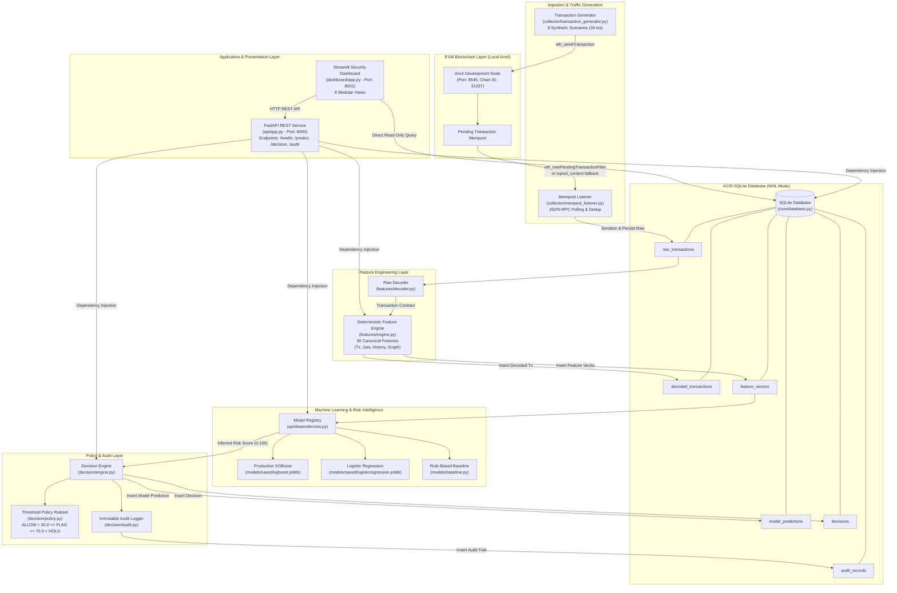
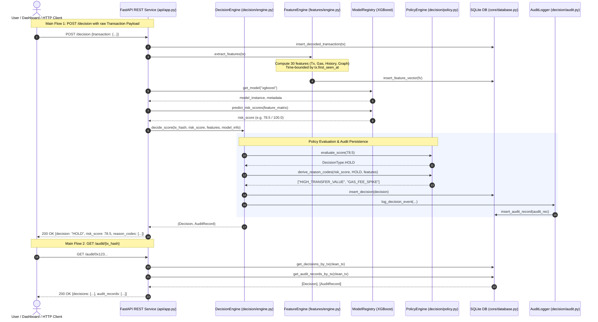
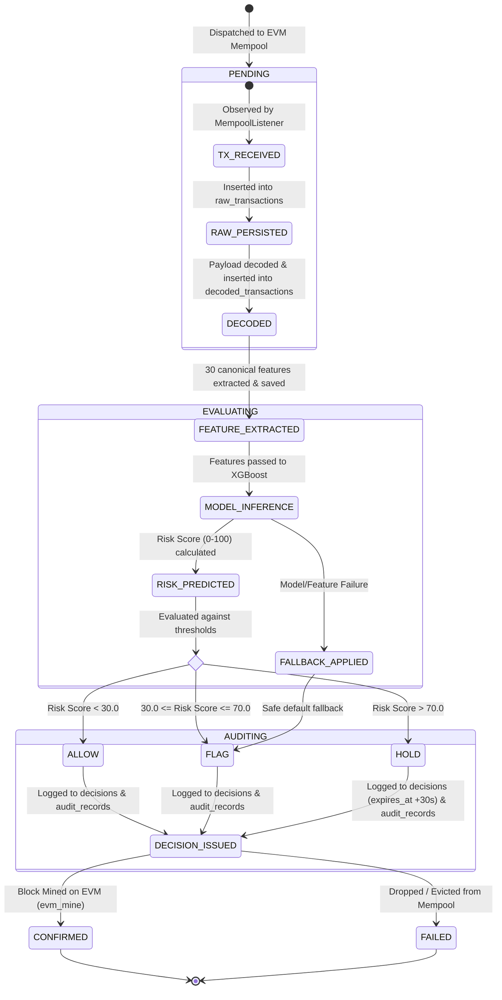

# MempoolGuard — Phase 2: Architecture & Code Flow Analysis Report

> **DISCLAIMER**: Synthetic proof-of-concept labels; not evidence of real-world detection performance.
> ALLOW, FLAG, and HOLD are application-level simulated decisions. They do not modify blockchain consensus or guarantee transaction interception.

---

## 1. Module Responsibilities & Component Mapping

| Subsystem / Module | File Path | Primary Responsibilities |
|:---|:---|:---|
| **Core Contracts** | [`core/contracts.py`](file:///c:/Users/USER/Downloads/PD-PROJECT/miniproject/core/contracts.py) | Defines Pydantic data contracts (`Transaction`, `FeatureVector`, `RiskResult`, `Decision`, `AuditRecord`) and strict field validators (0x hex checking, UTC enforcement, non-negative gas/value). |
| **Persistence Layer** | [`core/database.py`](file:///c:/Users/USER/Downloads/PD-PROJECT/miniproject/core/database.py) | Encapsulates SQLite connection lifecycle, WAL mode, schema initialization (`raw_transactions`, `decoded_transactions`, `feature_vectors`, `model_predictions`, `decisions`, `audit_records`), relational indexing, and ACID transaction context management. |
| **System Diagnostics** | [`core/health.py`](file:///c:/Users/USER/Downloads/PD-PROJECT/miniproject/core/health.py) | Provides diagnostic probes across Python environment, SQLite database read/write integrity, RPC node availability, and storage directory presence. Gracefully yields `DEGRADED` if RPC node is offline. |
| **Configuration** | [`core/config.py`](file:///c:/Users/USER/Downloads/PD-PROJECT/miniproject/core/config.py) | Parses and validates hierarchical YAML (`configs/config.yaml`) with environment variable overrides (`MEMPOOLGUARD_*`), enforcing schema invariants via Pydantic. |
| **EVM Controller** | [`core/anvil.py`](file:///c:/Users/USER/Downloads/PD-PROJECT/miniproject/core/anvil.py) | Manages local Anvil process lifecycle (`start`, `stop`, `is_running`, `set_automine`, `mine_blocks`) and automatic detection of the Anvil binary in PATH or `~/.foundry/bin`. |
| **Mempool Listener** | [`collector/mempool_listener.py`](file:///c:/Users/USER/Downloads/PD-PROJECT/miniproject/collector/mempool_listener.py) | Dedicated background thread polling pending transactions via `eth_newPendingTransactionFilter` (with `txpool_content` and pending block fallbacks), deduplicating hashes, and persisting raw JSON payloads. |
| **Traffic Generator** | [`collector/transaction_generator.py`](file:///c:/Users/USER/Downloads/PD-PROJECT/miniproject/collector/transaction_generator.py) | Generates 8 deterministic synthetic and benign scenarios (34 transactions) covering standard transfers, bursts, gas price spikes, probe calls, and fan-outs. |
| **Payload Decoder** | [`features/decoder.py`](file:///c:/Users/USER/Downloads/PD-PROJECT/miniproject/features/decoder.py) | Parses serialized raw JSON transaction dictionaries into typed `Transaction` models, normalizing hex fields, timestamps, and computing feature availability flags. |
| **Feature Engine** | [`features/engine.py`](file:///c:/Users/USER/Downloads/PD-PROJECT/miniproject/features/engine.py) | Deterministically extracts 30 canonical pre-confirmation features across 4 groups (Transaction, Gas, Historical Address, Sliding Window & Graph) strictly time-bounded by `first_seen_at`. |
| **Dataset Pipeline** | [`dataset/builder.py`](file:///c:/Users/USER/Downloads/PD-PROJECT/miniproject/dataset/builder.py), [`dataset/splitter.py`](file:///c:/Users/USER/Downloads/PD-PROJECT/miniproject/dataset/splitter.py) | Joins feature vectors with scenario manifests into Parquet/CSV formats, enforcing strictly chronological splits (`train` $\le$ `val` $\le$ `test`) to prevent temporal leakage. |
| **Machine Learning** | [`models/xgboost_model.py`](file:///c:/Users/USER/Downloads/PD-PROJECT/miniproject/models/xgboost_model.py), [`models/logistic.py`](file:///c:/Users/USER/Downloads/PD-PROJECT/miniproject/models/logistic.py), [`models/baseline.py`](file:///c:/Users/USER/Downloads/PD-PROJECT/miniproject/models/baseline.py) | Encapsulates model families: production calibrated XGBoost, scaled Logistic Regression, and rule-based heuristic baseline. |
| **Model Registry** | [`api/dependencies.py`](file:///c:/Users/USER/Downloads/PD-PROJECT/miniproject/api/dependencies.py#L19-L100) | Manages in-memory cached model instances loaded from `models/saved/` (`xgboost.joblib`, `logisticregression.joblib`, `rulebaseline_metadata.json`), verifying feature schema versions. |
| **Policy Engine** | [`decision/policy.py`](file:///c:/Users/USER/Downloads/PD-PROJECT/miniproject/decision/policy.py) | Implements three-tier risk threshold logic (`ALLOW` < 30.0 $\le$ `FLAG` $\le$ 70.0 < `HOLD`), generates explainable machine-readable reason codes, and provides safe fallback decisions. |
| **Decision Engine** | [`decision/engine.py`](file:///c:/Users/USER/Downloads/PD-PROJECT/miniproject/decision/engine.py) | Orchestrates risk evaluation, checks idempotency, invokes policy thresholds, derives reason codes, handles NaN/infinite score failures, and triggers relational audit persistence. |
| **Audit Logger** | [`decision/audit.py`](file:///c:/Users/USER/Downloads/PD-PROJECT/miniproject/decision/audit.py) | Constructs immutable `AuditRecord` entries and persists them to SQLite for compliance and forensic tracing. |
| **REST API Service** | [`api/app.py`](file:///c:/Users/USER/Downloads/PD-PROJECT/miniproject/api/app.py) | Exposes FastAPI REST endpoints (`/health`, `/predict`, `/decision`, `/decision/simulate`, `/audit/{tx_hash}`) with CORS and structured validation error handling. |
| **Security Dashboard** | [`dashboard/app.py`](file:///c:/Users/USER/Downloads/PD-PROJECT/miniproject/dashboard/app.py) | Streamlit dashboard providing 8 interactive perspectives (Overview, Transactions, Risk, Decisions, Audit, Models, Analytics, Inspector). |

---

## 2. Call Chains & Execution Traces

### Chain 1: Live Mempool Observation to Raw Ingestion
- **Entry Point**: `python -m collector.mempool_listener --rpc http://127.0.0.1:8545 --db data/mempoolguard.db` ([`collector/mempool_listener.py#L320`](file:///c:/Users/USER/Downloads/PD-PROJECT/miniproject/collector/mempool_listener.py#L320))
- **Inputs**: CLI flags (`--rpc`, `--db`, `--interval`, `--duration`).
- **Processing**:
  1. `MempoolListener.start()` launches a daemon worker thread ([`collector/mempool_listener.py#L112`](file:///c:/Users/USER/Downloads/PD-PROJECT/miniproject/collector/mempool_listener.py#L112)).
  2. Creates filter via `w3.eth.filter("pending")`. If filter raises, falls back to `_poll_via_txpool()` or `_poll_via_pending_block()` ([`collector/mempool_listener.py#L182-L245`](file:///c:/Users/USER/Downloads/PD-PROJECT/miniproject/collector/mempool_listener.py#L182-L245)).
  3. Deduplicates transaction hashes against an in-memory sliding cache (`seen_tx_hashes = deque(maxlen=50000)`).
  4. Serializes transaction dictionaries safely handling `HexBytes` via `serialize_raw_transaction()` ([`collector/mempool_listener.py#L32-L49`](file:///c:/Users/USER/Downloads/PD-PROJECT/miniproject/collector/mempool_listener.py#L32-L49)).
- **Data Stores**:
  - `db.insert_raw_transaction(tx_hash, raw_payload, first_seen_at)` writes to table `raw_transactions` with `ON CONFLICT DO NOTHING` ([`core/database.py#L201-L220`](file:///c:/Users/USER/Downloads/PD-PROJECT/miniproject/core/database.py#L201-L220)).
- **External Calls**: Web3 JSON-RPC over HTTP (`eth_newPendingTransactionFilter`, `eth_getFilterChanges`, `eth_getTransaction`).
- **Outputs**: Terminal log and invocation of `on_transaction_captured` callback.

---

### Chain 2: Feature Extraction Pipeline
- **Entry Point**: `python -m features.engine --hash <0x...>` ([`features/engine.py#L374`](file:///c:/Users/USER/Downloads/PD-PROJECT/miniproject/features/engine.py#L374)) or internal call from API / Demo.
- **Inputs**: 66-character lowercase transaction hash.
- **Processing**:
  1. `FeatureEngine.extract_from_raw_hash(tx_hash)` queries `db.get_raw_transaction(tx_hash)`.
  2. `decode_raw_transaction(raw_record)` in [`features/decoder.py#L18`](file:///c:/Users/USER/Downloads/PD-PROJECT/miniproject/features/decoder.py#L18) parses payload into `Transaction` contract.
  3. `FeatureEngine.extract_features(tx)` calculates canonical 30 features:
     - *Tx Level*: `value_eth`, `gas_limit`, `gas_price_gwei`, `calldata_size_bytes`, `is_contract_call`, `function_selector_hash`, `nonce`, etc.
     - *History*: Queries prior transactions for `sender` and `receiver` where `first_seen_at <= tx.first_seen_at` ([`features/engine.py#L170-L215`](file:///c:/Users/USER/Downloads/PD-PROJECT/miniproject/features/engine.py#L170-L215)).
     - *Window*: Queries transactions within `(tx.first_seen_at - 60s, tx.first_seen_at]` ([`features/engine.py#L220-L280`](file:///c:/Users/USER/Downloads/PD-PROJECT/miniproject/features/engine.py#L220-L280)).
     - *Graph*: Constructs NetworkX directed multigraph of historical sender-receiver interactions to derive in/out degrees and PageRank ([`features/engine.py#L285-L330`](file:///c:/Users/USER/Downloads/PD-PROJECT/miniproject/features/engine.py#L285-L330)).
- **Data Stores**:
  - `db.insert_decoded_transaction(tx)` into `decoded_transactions`.
  - `db.insert_feature_vector(fv)` into `feature_vectors` ([`core/database.py#L274-L295`](file:///c:/Users/USER/Downloads/PD-PROJECT/miniproject/core/database.py#L274-L295)).
- **Outputs**: Strongly typed `FeatureVector` object containing 30 named float features and availability mask.

---

### Chain 3: REST API Risk Prediction & Decision
- **Entry Point**: `POST /decision` on FastAPI service ([`api/routes/decision.py#L61`](file:///c:/Users/USER/Downloads/PD-PROJECT/miniproject/api/routes/decision.py#L61)).
- **Inputs**: JSON body with `transaction` object or pre-computed `features` dictionary.
- **Processing**:
  1. `_prepare_decision_features()` validates transaction, stores to DB, and calls `feature_engine.extract_features(tx)` ([`api/routes/decision.py#L30-L58`](file:///c:/Users/USER/Downloads/PD-PROJECT/miniproject/api/routes/decision.py#L30-L58)).
  2. `registry.get_model("xgboost")` fetches model and metadata ([`api/dependencies.py#L80`](file:///c:/Users/USER/Downloads/PD-PROJECT/miniproject/api/dependencies.py#L80)).
  3. `model.predict_risk_scores(feature_df)` executes inference, returning calibrated score $S \in [0.0, 100.0]$.
  4. `decision_engine.decide_score(...)` in [`decision/engine.py#L61`](file:///c:/Users/USER/Downloads/PD-PROJECT/miniproject/decision/engine.py#L61):
     - Checks idempotency: if tx was previously evaluated with identical policy version, returns cached decision ([`decision/engine.py#L88-L105`](file:///c:/Users/USER/Downloads/PD-PROJECT/miniproject/decision/engine.py#L88-L105)).
     - Checks score validity (non-null, non-inf, non-nan). If invalid, triggers safe fallback `FLAG` ([`decision/engine.py#L117-L163`](file:///c:/Users/USER/Downloads/PD-PROJECT/miniproject/decision/engine.py#L117-L163)).
     - Evaluates score: `score < 30.0` $\to$ `ALLOW`, `30.0 <= score <= 70.0` $\to$ `FLAG`, `score > 70.0` $\to$ `HOLD` ([`decision/policy.py#L52-L65`](file:///c:/Users/USER/Downloads/PD-PROJECT/miniproject/decision/policy.py#L52-L65)).
     - Derives explanatory reason codes (e.g. `HIGH_TRANSFER_VALUE`, `GAS_FEE_SPIKE`, `RAPID_BURST_ACTIVITY`).
- **Data Stores**:
  - `db.insert_prediction(risk_result)` $\to$ `model_predictions`.
  - `db.insert_decision(decision)` $\to$ `decisions`.
  - `audit_logger.log_decision_event(...)` $\to$ `audit_records` ([`decision/audit.py#L40-L75`](file:///c:/Users/USER/Downloads/PD-PROJECT/miniproject/decision/audit.py#L40-L75)).
- **Outputs**: HTTP 200 `DecisionResponse` with decision, risk score, reason codes, policy version, and timestamps.

---

### Chain 4: Audit & Observability Lookup
- **Entry Point**: `GET /audit/{tx_hash}` ([`api/routes/audit.py#L16`](file:///c:/Users/USER/Downloads/PD-PROJECT/miniproject/api/routes/audit.py#L16)) or Streamlit Audit Explorer.
- **Inputs**: Path parameter `tx_hash`.
- **Processing**:
  1. Validates 66-character hex format via `_validate_hex_hash()` ([`api/schemas.py#L14-L22`](file:///c:/Users/USER/Downloads/PD-PROJECT/miniproject/api/schemas.py#L14-L22)).
  2. Queries `db.get_decisions_by_tx(clean_tx)` and `db.get_audit_records_by_tx(clean_tx)` ([`core/database.py#L460-L510`](file:///c:/Users/USER/Downloads/PD-PROJECT/miniproject/core/database.py#L460-L510)).
- **Data Stores**: Read queries against indexed tables `decisions` and `audit_records`.
- **Outputs**: HTTP 200 `AuditLookupResponse` containing full chronological decision history and immutable audit trail.

---

## 3. Data Models, Schemas, & State Invariants

### A. SQLite Relational Schema ([`core/database.py#L101-L195`](file:///c:/Users/USER/Downloads/PD-PROJECT/miniproject/core/database.py#L101-L195))

1. **`raw_transactions`**:
   - `tx_hash` (TEXT PRIMARY KEY)
   - `raw_payload` (TEXT NOT NULL, JSON string)
   - `first_seen_at` (TEXT NOT NULL, ISO UTC)
   - `captured_at` (TEXT NOT NULL, ISO UTC)

2. **`decoded_transactions`**:
   - `tx_hash` (TEXT PRIMARY KEY, FK $\to$ `raw_transactions.tx_hash` ON DELETE CASCADE)
   - `chain_id` (INTEGER NOT NULL), `sender` (TEXT NOT NULL), `receiver` (TEXT NULLABLE)
   - `value_wei` (TEXT NOT NULL), `nonce` (INTEGER NOT NULL), `gas_limit` (INTEGER NOT NULL)
   - `gas_price_wei` (TEXT), `max_fee_per_gas_wei` (TEXT), `max_priority_fee_per_gas_wei` (TEXT)
   - `input_data` (TEXT NOT NULL), `first_seen_at` (TEXT NOT NULL), `confirmed_at` (TEXT NULLABLE)
   - `block_number` (INTEGER NULLABLE), `transaction_status` (TEXT NOT NULL: PENDING / CONFIRMED / FAILED)
   - `feature_availability` (TEXT NOT NULL, JSON string)

3. **`feature_vectors`**:
   - `id` (INTEGER PRIMARY KEY AUTOINCREMENT)
   - `tx_hash` (TEXT NOT NULL, FK $\to$ `raw_transactions.tx_hash` ON DELETE CASCADE)
   - `feature_timestamp` (TEXT NOT NULL), `features` (TEXT NOT NULL, JSON string of 30 values)
   - `feature_names` (TEXT NOT NULL, JSON array), `feature_version` (TEXT NOT NULL: "1.0.0")
   - `availability_mask` (TEXT NOT NULL), `missing_features` (TEXT NOT NULL)

4. **`model_predictions`**:
   - `id` (INTEGER PRIMARY KEY AUTOINCREMENT)
   - `tx_hash` (TEXT NOT NULL, FK $\to$ `raw_transactions.tx_hash`)
   - `risk_score` (REAL NOT NULL, 0.0 – 100.0), `predicted_class` (INTEGER NOT NULL: 0 or 1)
   - `model_name` (TEXT NOT NULL), `model_version` (TEXT NOT NULL)
   - `inference_latency_ms` (REAL NOT NULL), `reason_codes` (TEXT NOT NULL), `explanation` (TEXT NOT NULL)

5. **`decisions`**:
   - `id` (INTEGER PRIMARY KEY AUTOINCREMENT)
   - `tx_hash` (TEXT NOT NULL, FK $\to$ `raw_transactions.tx_hash`)
   - `decision` (TEXT NOT NULL: ALLOW / FLAG / HOLD)
   - `reason_codes` (TEXT NOT NULL, JSON list), `policy_version` (TEXT NOT NULL: "1.0.0")
   - `created_at` (TEXT NOT NULL), `expires_at` (TEXT NULLABLE)
   - `is_simulated` (INTEGER NOT NULL DEFAULT 1)

6. **`audit_records`**:
   - `audit_id` (TEXT PRIMARY KEY, UUIDv4)
   - `tx_hash` (TEXT NOT NULL), `event_type` (TEXT NOT NULL: TX_RECEIVED, FEATURE_EXTRACTED, RISK_PREDICTED, DECISION_ISSUED, FALLBACK_APPLIED, etc.)
   - `timestamp` (TEXT NOT NULL), `risk_score` (REAL NULLABLE), `decision` (TEXT NULLABLE)
   - `details` (TEXT NOT NULL, JSON payload), `error_info` (TEXT NULLABLE)

---

## 4. Error Handling, Retries, Security & Auth Analysis

### Error Handling & Safe Fallbacks
- **Model Inference & Score Failures**:
  - If a model returns `NaN`, `Inf`, or crashes during inference, [`decision/engine.py#L107-L163`](file:///c:/Users/USER/Downloads/PD-PROJECT/miniproject/decision/engine.py#L107-L163) catches the failure and automatically applies the configured `default_fallback_decision` (`FLAG` by default).
  - Emits event `FALLBACK_APPLIED` to `audit_records` with error details and stack summary ([`core/contracts.py#L51`](file:///c:/Users/USER/Downloads/PD-PROJECT/miniproject/core/contracts.py#L51)).
- **RPC Offline Handling**:
  - The health check module [`core/health.py#L58-L85`](file:///c:/Users/USER/Downloads/PD-PROJECT/miniproject/core/health.py#L58-L85) traps `urllib.error.URLError` and timeout errors, marking blockchain status as `DEGRADED` instead of crashing the server or throwing unhandled exceptions.
- **Database Concurrency & Locking**:
  - SQLite is initialized with `busy_timeout = 10000ms` and `PRAGMA journal_mode = WAL;` ([`core/database.py#L80-L82`](file:///c:/Users/USER/Downloads/PD-PROJECT/miniproject/core/database.py#L80-L82)). Atomic transactions are managed via a dedicated context manager with rollback on failure ([`core/database.py#L86-L97`](file:///c:/Users/USER/Downloads/PD-PROJECT/miniproject/core/database.py#L86-L97)).

### Security & Secrets Audit
- **Authentication**: REST API currently operates without authentication tokens or API keys (`allow_origins=["*"]` in [`api/app.py#L54`](file:///c:/Users/USER/Downloads/PD-PROJECT/miniproject/api/app.py#L54)), which is appropriate for a local research prototype.
- **Consensus Safety**: Decoupled from EVM consensus. All decisions explicitly set `is_simulated = True` ([`core/contracts.py#L260`](file:///c:/Users/USER/Downloads/PD-PROJECT/miniproject/core/contracts.py#L260)).
- **Input Validation**: Strict Pydantic models reject invalid Ethereum addresses (must be 42 characters starting with `0x`) and transaction hashes (must be 66 characters starting with `0x`) ([`core/contracts.py#L105-L129`](file:///c:/Users/USER/Downloads/PD-PROJECT/miniproject/core/contracts.py#L105-L129)).

---

## 5. Architectural Mermaid Diagrams

### (a) System Architecture Diagram

---

### (b) End-to-End Sequence Diagram

---

### (c) Data Flow Diagram

```mermaid
flowchart LR
    subgraph Ingestion["1. Ingestion Phase"]
        AnvilTX["Anvil Mempool (Pending Tx)"] -->|"eth_newPendingTransactionFilter"| ML["Mempool Listener"]
        ML -->|"Raw JSON String + first_seen_at"| RawTable[("raw_transactions<br/>(tx_hash, payload, first_seen_at)")]
    end

    subgraph Decoding["2. Decoding & Feature Extraction"]
        RawTable -->|"Raw Record"| Dec["Decoder (features/decoder.py)"]
        Dec -->|"Pydantic Transaction Object"| DecTable[("decoded_transactions<br/>(gas, nonce, value, sender, receiver)")]
        DecTable -->|"Decoded Tx + History Lookup"| FE["Feature Engine (features/engine.py)"]
        FE -->|"30 Canonical Features Map"| FVTable[("feature_vectors<br/>(features JSON, feature_version, availability)")]
    end

    subgraph Scoring["3. Machine Learning Inference"]
        FVTable -->|"1x30 Feature DataFrame"| XGB["XGBoost Classifier (models/xgboost_model.py)"]
        XGB -->|"Probability P(anomaly) * 100"| PredTable[("model_predictions<br/>(risk_score, predicted_class, latency)")]
    end

    subgraph Decisioning["4. Intervention Policy & Audit"]
        PredTable -->|"Risk Score (0.0-100.0)"| DE["Decision Engine (decision/engine.py)"]
        DE -->|"Thresholds: <30 ALLOW / <=70 FLAG / >70 HOLD"| DecTable2[("decisions<br/>(decision, reason_codes, expires_at)")]
        DE -->|"Event Log (Risk, Decision, Error, Timestamp)"| AuditTable[("audit_records<br/>(audit_id, tx_hash, event_type, details)")]
    end

    subgraph Observability["5. Presentation & Query Layer"]
        DecTable2 -->|"HTTP GET /audit/{tx_hash}"| API["FastAPI Service"]
        AuditTable -->|"HTTP GET /audit/{tx_hash}"| API
        API -->|"REST Responses"| UI["Streamlit Dashboard"]
        RawTable -.->|"Direct Read Query"| UI
        DecTable -.->|"Direct Read Query"| UI
        FVTable -.->|"Direct Read Query"| UI
        DecTable2 -.->|"Direct Read Query"| UI
        AuditTable -.->|"Direct Read Query"| UI
    end
```

---

### (d) Transaction State Machine Diagram

