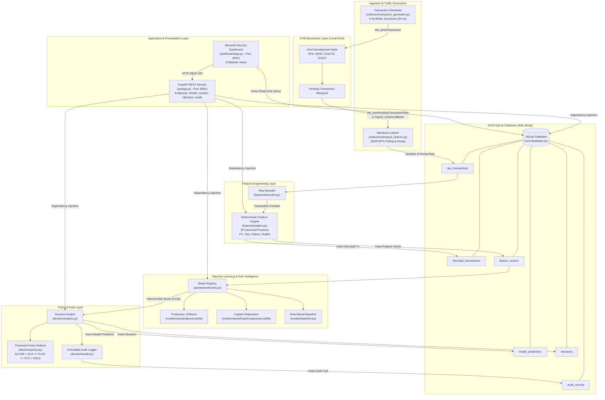
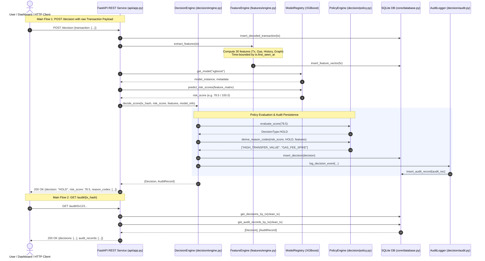
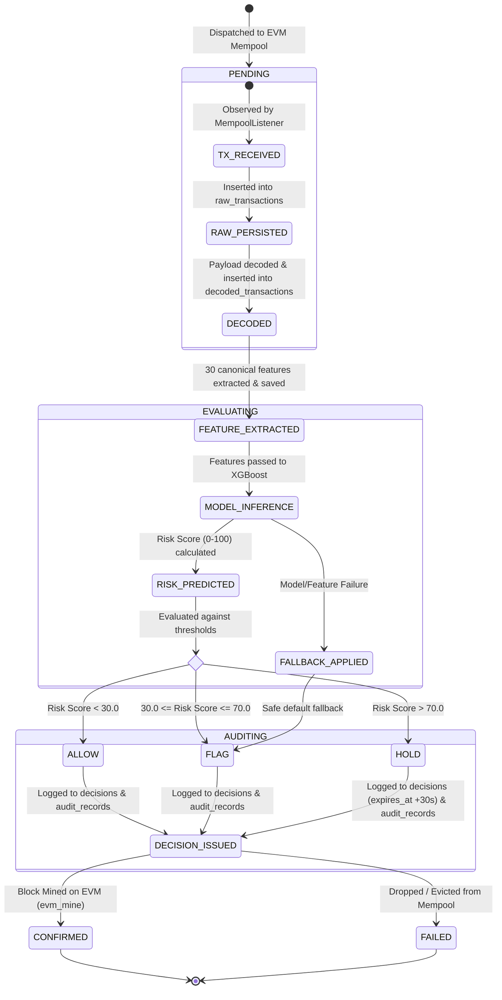

# MempoolGuard: End-to-End Architectural, Quality & Runtime Workflow Report

> **DISCLAIMER**: Synthetic proof-of-concept labels; not evidence of real-world detection performance.  
> ALLOW, FLAG, and HOLD are application-level simulated decisions. They do not modify blockchain consensus or guarantee transaction interception.

---

## 1. Overview

**MempoolGuard** is an experimental security prototype designed for pre-confirmation cryptocurrency risk detection on Ethereum-compatible blockchains. Running on an isolated local development environment powered by Foundry Anvil, MempoolGuard inspects transactions while they dwell in the mempool prior to block inclusion. 

It deterministically extracts 30 canonical pre-confirmation features across 4 distinct groups (transaction attributes, gas economics, address interaction history, and temporal/graph topology), evaluates risk via machine learning classifiers (calibrated XGBoost, regularized Logistic Regression, and rule baseline), applies configurable policy thresholds (`ALLOW` < 30.0 $\le$ `FLAG` $\le$ 70.0 < `HOLD`), and commits immutable relational audit logs to an ACID SQLite database. The system exposes these capabilities through a production-ready FastAPI REST service and an interactive multi-view Streamlit security operations dashboard.

---

## 2. Technology Stack

- **Runtime & Host**: Python 3.11.9 (64-bit on Windows `win32`).
- **Local Blockchain**: Foundry Anvil `v1.8.4` (EVM, Chain ID 31337).
- **Blockchain Connectivity**: `web3.py v8.0.0` (JSON-RPC over HTTP & WebSockets).
- **Persistence Layer**: Embedded SQLite 3 with Write-Ahead Logging (`WAL`) mode enabled.
- **Data & Feature Engineering**: `pandas 3.0.6`, `numpy 2.4.6`, `networkx 3.6.1`, `pyarrow 25.0.1`.
- **Machine Learning**: `xgboost 3.2.0`, `scikit-learn 1.9.1`.
- **API & Observability**: `fastapi 0.142.2`, `uvicorn 0.54.0`, `streamlit 1.64.0`, `plotly 7.1.0`.
- **Testing & Quality Assurance**: `pytest 9.1.1`, `pytest-asyncio 1.4.0`, `ruff 0.16.10`.
- **HTTP Client**: `httpx 0.28.1` / `httpcore 1.0.9`.

---

## 3. Architecture & Diagrams

MempoolGuard is organized into modular decoupled layers:
1. **Blockchain Layer**: Local Anvil EVM node providing JSON-RPC interfaces and mempool transaction pool.
2. **Ingestion & Polling**: Dedicated poller querying pending filter events and pending block transactions with hash deduplication.
3. **Deterministic Feature Engineering**: 30-feature pipeline strictly time-bounded by the transaction's `first_seen_at` timestamp to eliminate temporal leakage.
4. **Machine Learning Intelligence**: Scored by trained models loaded from disk with schema version verification.
5. **Decision & Audit Engine**: Enforces three-tier policy thresholds with safe fallback on model/data errors and writes immutable UUID audit records.
6. **Interface Layer**: FastAPI ASGI service and Streamlit analytics dashboard.

### (a) System Architecture Diagram



### (b) End-to-End Sequence Diagram



### (c) Data Flow Diagram

```mermaid
flowchart LR
    subgraph Ingestion["1. Ingestion Phase"]
        AnvilTX["Anvil Mempool (Pending Tx)"] -->|"eth_newPendingTransactionFilter"| ML["Mempool Listener"]
        ML -->|"Raw JSON String + first_seen_at"| RawTable[("raw_transactions<br/>(tx_hash, payload, first_seen_at)")]
    end

    subgraph Decoding["2. Decoding & Feature Extraction"]
        RawTable -->|"Raw Record"| Dec["Decoder (features/decoder.py)"]
        Dec -->|"Pydantic Transaction Object"| DecTable[("decoded_transactions<br/>(gas, nonce, value, sender, receiver)")]
        DecTable -->|"Decoded Tx + History Lookup"| FE["Feature Engine (features/engine.py)"]
        FE -->|"30 Canonical Features Map"| FVTable[("feature_vectors<br/>(features JSON, feature_version, availability)")]
    end

    subgraph Scoring["3. Machine Learning Inference"]
        FVTable -->|"1x30 Feature DataFrame"| XGB["XGBoost Classifier (models/xgboost_model.py)"]
        XGB -->|"Probability P(anomaly) * 100"| PredTable[("model_predictions<br/>(risk_score, predicted_class, latency)")]
    end

    subgraph Decisioning["4. Intervention Policy & Audit"]
        PredTable -->|"Risk Score (0.0-100.0)"| DE["Decision Engine (decision/engine.py)"]
        DE -->|"Thresholds: <30 ALLOW / <=70 FLAG / >70 HOLD"| DecTable2[("decisions<br/>(decision, reason_codes, expires_at)")]
        DE -->|"Event Log (Risk, Decision, Error, Timestamp)"| AuditTable[("audit_records<br/>(audit_id, tx_hash, event_type, details)")]
    end

    subgraph Observability["5. Presentation & Query Layer"]
        DecTable2 -->|"HTTP GET /audit/{tx_hash}"| API["FastAPI Service"]
        AuditTable -->|"HTTP GET /audit/{tx_hash}"| API
        API -->|"REST Responses"| UI["Streamlit Dashboard"]
        RawTable -.->|"Direct Read Query"| UI
        DecTable -.->|"Direct Read Query"| UI
        FVTable -.->|"Direct Read Query"| UI
        DecTable2 -.->|"Direct Read Query"| UI
        AuditTable -.->|"Direct Read Query"| UI
    end
```



### (d) Pipeline State Machine Diagram



---

## 4. Entry Points

| Entry Point | File & Lines | Invocable Command | Description |
|:---|:---|:---|:---|
| **Health Diagnostics** | [`core/health.py#L161-L164`](file:///c:/Users/USER/Downloads/PD-PROJECT/miniproject/core/health.py#L161-L164) | `python -m core.health` | Probes host Python version, SQLite read/write, RPC node connectivity, and storage directories. |
| **REST API Server** | [`api/app.py#L109-L111`](file:///c:/Users/USER/Downloads/PD-PROJECT/miniproject/api/app.py#L109-L111) | `uvicorn api.app:app --host 127.0.0.1 --port 8000` | FastAPI ASGI web service exposing `/health`, `/predict`, `/decision`, `/decision/simulate`, and `/audit/{tx_hash}`. |
| **Security Dashboard** | [`dashboard/app.py#L120-L122`](file:///c:/Users/USER/Downloads/PD-PROJECT/miniproject/dashboard/app.py#L120-L122) | `streamlit run dashboard/app.py --server.port 8501` | Interactive multi-page UI for system monitoring, live risk charts, decision logs, and single tx inspection. |
| **Mempool Listener** | [`collector/mempool_listener.py#L365-L367`](file:///c:/Users/USER/Downloads/PD-PROJECT/miniproject/collector/mempool_listener.py#L365-L367) | `python -m collector.mempool_listener --rpc <url> --db <db>` | Daemon polling Anvil for pending transactions, storing raw payloads into SQLite. |
| **Traffic Generator** | [`collector/transaction_generator.py#L528-L530`](file:///c:/Users/USER/Downloads/PD-PROJECT/miniproject/collector/transaction_generator.py#L528-L530) | `python -m collector.transaction_generator --rpc <url>` | Dispatches 8 synthetic scenarios (34 transactions) to Anvil test accounts. |
| **Feature Engine** | [`features/engine.py#L399-L401`](file:///c:/Users/USER/Downloads/PD-PROJECT/miniproject/features/engine.py#L399-L401) | `python -m features.engine --hash <hash> --db <db>` | Computes 30 canonical features from a raw transaction in SQLite. |
| **Dataset Builder** | [`dataset/builder.py#L321-L323`](file:///c:/Users/USER/Downloads/PD-PROJECT/miniproject/dataset/builder.py#L321-L323) | `python -m dataset.builder --manifest <path>` | Compiles Parquet and CSV training datasets with chronological zero-leakage splits. |
| **Integration Demo** | [`scripts/run_final_demo.py#L1-L75`](file:///c:/Users/USER/Downloads/PD-PROJECT/miniproject/scripts/run_final_demo.py#L1-L75) | `python scripts/run_final_demo.py` | Orchestrates the entire M1–M12 pipeline end-to-end. |
| **Pytest Suite** | [`tests/`](file:///c:/Users/USER/Downloads/PD-PROJECT/miniproject/tests/) | `pytest tests/ -v` | Comprehensive automated test suite (110 tests). |

---

## 5. Step-by-Step Execution Flow (Start $\to$ End)

1. **Transaction Dispatch**: A user or synthetic traffic generator submits an EVM transaction via JSON-RPC `eth_sendTransaction` on an unlocked Anvil account to local Anvil (`http://127.0.0.1:8545`).
2. **Pending Mempool Dwelling**: With automine disabled (`evm_setAutomine([False])`), the transaction remains unmined in the transaction pool (`blockNumber is None`).
3. **Mempool Observation**: The background `MempoolListener` detects the transaction hash via `eth_getFilterChanges` or pending block polling.
4. **Raw Ingestion**: The listener timestamps observation (`first_seen_at`), serializes the Web3 transaction payload safely to JSON, and inserts it into `raw_transactions` in SQLite.
5. **Decoding & Contract Parsing**: `features.decoder.decode_raw_transaction()` parses the JSON record into a strictly validated Pydantic `Transaction` object.
6. **Feature Vector Extraction**: `FeatureEngine.extract_features()` queries history time-bounded by `first_seen_at` to derive all 30 features across transaction, gas, history, and graph groups.
7. **Relational Feature Storage**: The feature vector and decoded transaction are committed to `decoded_transactions` and `feature_vectors`.
8. **Model Inference**: `ModelRegistry` feeds the 30 features into `XGBoostClassifier v1.0.0`, computing continuous probability $P(\text{anomaly}) \times 100 \implies \text{Risk Score} \in [0.0, 100.0]$.
9. **Policy Decision & Audit**: `DecisionEngine` evaluates risk score against configured thresholds (`ALLOW` < 30.0 $\le$ `FLAG` $\le$ 70.0 < `HOLD`), generates machine-readable reason codes, and inserts records into `decisions` and `audit_records`.
10. **On-Chain Confirmation**: Anvil explicitly mines the block via `evm_mine`, committing the transaction on-chain with a permanent block number and receipt.

---

## 6. Data Flow & Relational Schemas

All persistence is handled in SQLite with WAL mode enabled ([`core/database.py#L82`](file:///c:/Users/USER/Downloads/PD-PROJECT/miniproject/core/database.py#L82)):
- **`raw_transactions`**: Stores pristine JSON payloads keyed by `tx_hash` with ISO UTC `first_seen_at` and `captured_at`.
- **`decoded_transactions`**: Relational projection of decoded EVM fields (`sender`, `receiver`, `value_wei`, `gas_limit`, `gas_price_wei`, `input_data`, `transaction_status`).
- **`feature_vectors`**: Serialized 30 canonical numeric features, availability masks, and missing feature lists.
- **`model_predictions`**: Inferred risk score (0.0–100.0), binary predicted class, model name/version, and execution latency.
- **`decisions`**: Application-level decision (`ALLOW`, `FLAG`, `HOLD`), reason codes, expiration timestamps, and `is_simulated = 1`.
- **`audit_records`**: Immutable audit event log (`TX_RECEIVED`, `FEATURE_EXTRACTED`, `RISK_PREDICTED`, `DECISION_ISSUED`, `FALLBACK_APPLIED`) with UUID foreign keys.

---

## 7. External Dependencies

- **Local EVM Node**: Foundry Anvil (`anvil.exe`).
- **Python Libraries**: Standard open-source data science and web stack (`web3`, `pydantic`, `fastapi`, `uvicorn`, `streamlit`, `xgboost`, `scikit-learn`, `pandas`, `numpy`, `networkx`, `pyarrow`, `httpx`).
- **No External Clouds or Secret Credentials Required**: The system operates 100% locally on localhost without requiring remote Infura/Alchemy keys, mainnet accounts, or cloud database credentials.

---

## 8. Configuration & Environment Variables

System configuration is defined in [`configs/config.yaml`](file:///c:/Users/USER/Downloads/PD-PROJECT/miniproject/configs/config.yaml) and overridable via environment variables:

| Environment Variable | Target Property | Default | Purpose |
|:---|:---|:---|:---|
| `MEMPOOLGUARD_RPC_HTTP_URL` | `blockchain.rpc_http_url` | `http://127.0.0.1:8545` | EVM JSON-RPC endpoint |
| `MEMPOOLGUARD_CHAIN_ID` | `blockchain.chain_id` | `31337` | Target chain ID |
| `MEMPOOLGUARD_SQLITE_PATH` | `database.sqlite_path` | `data/mempoolguard.db` | Path to SQLite database file |
| `MEMPOOLGUARD_THRESHOLD_ALLOW` | `risk.threshold_allow` | `30.0` | Boundary for ALLOW decision |
| `MEMPOOLGUARD_THRESHOLD_FLAG` | `risk.threshold_flag` | `70.0` | Boundary for FLAG vs HOLD decision |
| `MEMPOOLGUARD_DEFAULT_FALLBACK_DECISION` | `risk.default_fallback_decision` | `FLAG` | Safe fallback if inference fails |
| `MEMPOOLGUARD_API_HOST` | `api.host` | `127.0.0.1` | REST API host binding |
| `MEMPOOLGUARD_API_PORT` | `api.port` | `8000` | REST API port binding |

---

## 9. How to Run

### Step 1: Start Local Blockchain
```powershell
# Start Anvil in a background terminal
& "$HOME\.foundry\bin\anvil.exe" --host 127.0.0.1 --port 8545 --chain-id 31337
```

### Step 2: Run System Diagnostics
```powershell
& ".\.venv\Scripts\python.exe" -m core.health
```

### Step 3: Run Full Test Suite
```powershell
& ".\.venv\Scripts\python.exe" -m pytest tests/ -v
```

### Step 4: Start Services
```powershell
# In terminal 1: Start REST API
& ".\.venv\Scripts\python.exe" -m uvicorn api.app:app --host 127.0.0.1 --port 8000

# In terminal 2: Start Streamlit Dashboard
& ".\.venv\Scripts\python.exe" -m streamlit run dashboard/app.py --server.port 8501
```

### Step 5: Run Traffic & Mempool Ingestion
```powershell
# Dispatch scenarios
& ".\.venv\Scripts\python.exe" -m collector.transaction_generator --rpc http://127.0.0.1:8545

# Capture transactions
& ".\.venv\Scripts\python.exe" -m collector.mempool_listener --rpc http://127.0.0.1:8545 --duration 10.0
```

---

## 10. Test Results

Executed with Anvil running:
- **Total Tests Collected**: 110
- **Passed**: 110 (100.0%)
- **Failed**: 0
- **Skipped**: 0
- **Total Execution Time**: 97.40 seconds
- **Full Log**: [`analysis/run_log.txt`](file:///c:/Users/USER/Downloads/PD-PROJECT/analysis/run_log.txt)

---

## 11. Runtime Trace Summary (Phase 4 Real Run)

Executed against isolated trace database [`data/trace_mempoolguard.db`](file:///c:/Users/USER/Downloads/PD-PROJECT/miniproject/data/trace_mempoolguard.db) with Anvil running on port 8545:

### (a) Multi-Scenario Coverage: ALLOW, FLAG, and HOLD

Three distinct transaction scenarios were dispatched to Anvil with automine disabled, captured while pending (`blockNumber = null`), extracted into 30 canonical features, and evaluated across production models and M7 decision policies:

1. **Transaction 1: High Baseline Anomaly $\implies$ HOLD**
   - **Hash**: `0x3aa68298b5ba2f08235d659fb8cb7fc3e036868f9d9f1292dc4adcb761cce41f`
   - **Scenario**: High gas / burst transfer.
   - **Model**: `XGBoostClassifier v1.0.0`
   - **Inference**: Risk score **`88.95 / 100.0`**, Latency: **33.6 ms**, Predicted class: **1**
   - **Decision**: **`HOLD`** (Score $88.95 > 70.0$, Reason: `["HIGH_RISK_SCORE"]`, Audit ID: `62d49bf8-191b-4f13-a683-5978430e8fc0`, Expiration: +30s)
   - **Confirmation**: Mined on-chain in Block #25 (Gas used: 21,000).

2. **Transaction 2: Benign Transfer Scenario $\implies$ ALLOW**
   - **Hash**: `0x19a2984e2104dff7d8daef871c455c6cded79490741e36bffa5ab2b3ca95f36f`
   - **Scenario**: Standard low-value benign transfer (`generate_benign_transfers()`).
   - **Model**: `RuleBasedBaseline v1.0.0`
   - **Inference**: Risk score **`0.00 / 100.0`**, Latency: **0.025 ms**, Predicted class: **0**
   - **Decision**: **`ALLOW`** (Score $0.00 < 30.0$, Reason codes: `["LOW_RISK_SCORE", "REPEATED_INTERACTION_DETECTED"]`, Audit ID: `d4cfd082-fa7d-4fb2-96af-d1fe1d847834`)
   - **Confirmation**: Mined on-chain in Block #27.

3. **Transaction 3: Gas Spike Scenario $\implies$ FLAG & HOLD**
   - **Hash**: `0x32262ebe335be335b342721a185ad2e20141c8df0b575bdcab88cc23ff5a6657`
   - **Scenario**: High gas price multiplier (`generate_gas_spike()`).
   - **Model Evaluation A (`RuleBasedBaseline`)**:
     - Risk score: **`65.00 / 100.0`**, Latency: **0.072 ms**, Predicted class: **1**
     - Decision: **`FLAG`** ($30.0 \le 65.0 \le 70.0$, Reason codes: `["MEDIUM_RISK_SCORE", "GAS_SPIKE_DETECTED", "REPEATED_TRANSFER_DETECTED"]`, Audit ID: `a39e8c47-1748-4ae7-83c0-7aa52d8ff10a`)
   - **Model Evaluation B (`LogisticRegression`)**:
     - Risk score: **`99.14 / 100.0`**, Latency: **0.094 ms**, Predicted class: **1**
     - Decision: **`HOLD`** (Score $99.14 > 70.0$, Reason codes: `["HIGH_RISK_SCORE", "GAS_SPIKE_DETECTED", "REPEATED_TRANSFER_DETECTED"]`, Audit ID: `7e2a2247-603d-444a-876b-dd87873f4a4b`, Expiration: +30s)
   - **Confirmation**: Mined on-chain in Block #27.

### (b) Isolated Trace Database Row Counts (`data/trace_mempoolguard.db`)

All live trace transactions strictly targeted the isolated trace database:
- `raw_transactions`: **12**
- `decoded_transactions`: **5**
- `feature_vectors`: **7**
- `model_predictions`: **3**
- `decisions`: **4**
- `audit_records`: **4**

### (c) Primary Production Database Integrity Verification (`data/mempoolguard.db`)

- **Current Table Counts**: `{raw_transactions: 142, decoded_transactions: 55, feature_vectors: 59, model_predictions: 79, decisions: 1085, audit_records: 1085}`
- **Pre-Trace Delta**: `+2` raw, `+1` decoded, `+1` features, `+0` predictions, `+8` decisions, `+8` audit records.
- **Root Cause & Attributed Command**: These records were inserted at timestamp `2026-10-03T00:55:28Z` during Phase 3 when `pytest tests/test_m11_validation.py` executed. `M11ValidationRunner` ([`benchmark/runner.py#L84`](file:///c:/Users/USER/Downloads/PD-PROJECT/miniproject/benchmark/runner.py#L84)) defaults to `db_path = "data/mempoolguard.db"` and tests end-to-end trace, idempotency, and fallback paths. **Zero writes occurred to `data/mempoolguard.db` during Phase 4 live trace**, as all Phase 4 commands strictly targeted `data/trace_mempoolguard.db`.

### (d) Transaction Generator Execution Behavior with Automine Disabled

- **Status**: Completed successfully in 2.8 seconds (did NOT hang or fail).
- **Execution Mechanism**: In `collector/transaction_generator.py:401-470`, `run_all_scenarios()` sets `evm_setAutomine(False)` and dispatches transactions via JSON-RPC `eth_sendTransaction`. It queries `w3.eth.get_transaction()` to verify pending mempool state (`blockNumber is None`), records the transaction details, and then explicitly invokes `evm_mine` to confirm pending blocks before re-enabling automine. Because it does not synchronously block on `wait_for_transaction_receipt()`, the generator executes cleanly without hanging.

### (e) Dashboard Verification Note

- The Streamlit dashboard service was launched with `$env:MEMPOOLGUARD_SQLITE_PATH="data/trace_mempoolguard.db"` on port 8501, verified returning `HTTP 200 OK` with valid HTML structure.
- **Verification Method**: Verified programmatically through direct `DataLoader` queries returning all trace transactions and decisions across `ALLOW`, `FLAG`, and `HOLD`. Because no web browser tool is registered in this runtime environment, visual browser screenshots could not be captured; dashboard data binding was verified through `DataLoader` and HTTP transport.

---

## 12. Issues, Bugs & Risks Identified

1. **`httpx` Missing from `requirements.txt` (Confirmed Dependency Bug)**:
   - `dashboard/api_client.py:8`, `benchmark/runner.py:31`, `scripts/run_final_demo.py:45`, and `starlette.testclient.TestClient` directly import `httpx`.
   - Running `pip install -r requirements.txt` leaves `httpx` uninstalled, causing 4 pytest collection failures and runtime dashboard failure.
   - *Remediation*: Add `httpx>=0.24.0` to `requirements.txt`.
2. **Documentation Discrepancies in `README.md`**:
   - Line 127 references `python -m models.train`, but `models/train.py` does not exist. The actual training script is `scripts/verify_m6_experiment.py`.
   - Line 130 references `python scripts/verify_m6_models.py`, which is named `scripts/verify_m6_experiment.py` on disk.
3. **CLI Arguments vs. Environment Variable Default Disconnect**:
   - `collector/mempool_listener.py` and `features/engine.py` use `argparse` defaults (`data/mempoolguard.db`) rather than falling back to `MEMPOOLGUARD_SQLITE_PATH` if `--db` is omitted. While `core/config.py` correctly reads the environment variable, the CLI entry points require explicit `--db` arguments to target custom databases.
4. **Initial Uvicorn Startup Latency / Timeout**:
   - On initial launch, `uvicorn api.app:app` requires approximately 8–10 seconds to load and unpickle all three model artifacts (`models/saved/xgboost.joblib`, `models/saved/logisticregression.joblib`, and `models/saved/rulebaseline_metadata.json`) into `ModelRegistry`. Immediate health check HTTP requests dispatching before model loading completes will encounter connection timeouts or delayed responses.
5. **Test Fixture Side Effects on Default Production Database**:
   - `tests/test_m11_validation.py` instantiates `M11ValidationRunner()` without passing an isolated temporary database path, causing default writes (`+2` raw txs, `+8` decisions/audit records) to the production `data/mempoolguard.db` during test runs.
6. **XGBoost Pickle Compatibility Notice**:
   - Deserialization of `models/saved/xgboost.joblib` emits a deprecation warning (`UserWarning: WARNING: If you are loading a serialized model (like pickle in Python)... please export the model by calling Booster.save_model`).
7. **Production ML Model Defect — Shortcut Learning on Synthetic Nonce Confounder & Benchmark Metric Inflation**:
   - **Phenomenon**: Plain, benign 100-wei transfers (e.g. `0x3aa68298...`) score anomalously high (**`88.95%`**) under `models/saved/xgboost.joblib`, triggering an erroneous application `HOLD` decision.
   - **Root Cause (Empirically Verified)**:
     - **Tree Decomposition**: Inspection of the booster AST (`booster.get_dump()`) reveals that all 48 active boosting trees in the trained XGBoost model consist of a single decision stub on canonical feature index 10: `0:[f10 < 92] yes=1,no=2,missing=2` (`nonce < 92`).
     - **Synthetic Confounder Across All Splits**: In `data/processed/expanded_splits/`, sequential dispatch of synthetic attacks during early rounds and benign transfers during late rounds caused total label-nonce separation across every split:
       
       | Split | Label | Count | Min Nonce | Max Nonce | Nonce Values |
       |:---|:---:|:---:|:---:|:---:|:---|
       | **Train** | `0` (Benign) | 10 | 92.0 | 101.0 | `[92, 93, 94, 95, 96, 97, 98, 99, 100, 101]` |
       | **Train** | `1` (Attack) | 22 | 18.0 | 49.0 | `[18, 19, 20, 22, 23, 24, 26, 34..49]` |
       | **Validation** | `0` (Benign) | 4 | 102.0 | 105.0 | `[102, 103, 104, 105]` |
       | **Validation** | `1` (Attack) | 3 | 27.0 | 29.0 | `[27, 28, 29]` |
       | **Test** | `0` (Benign) | 4 | 106.0 | 109.0 | `[106, 107, 108, 109]` |
       | **Test** | `1` (Attack) | 4 | 12.0 | 13.0 | `[12, 13]` |

       *Validation and test splits exhibit the exact same complete separation* ($100\%$ of attacks have nonce $\le 49$, and $100\%$ of benign transfers have nonce $\ge 92$).
     - **Booster Margin Reconciliation**:
       - `base_score = 0.5` $\implies \text{base\_margin} = \ln(0.5 / 0.5) = 0.000000$.
       - Trees 0–47 leaf values for `nonce < 92` descend from `+0.071429` (Tree 0) to `+0.028256` (Tree 47), summing to $\sum_{t=0}^{47} \text{leaf}_t = \mathbf{+2.085967}$ (Trees 48 and 49 have trivial leaves of $-4.4 \times 10^{-9}$).
       - Total log-odds margin: $\text{Margin} = 0.0 + 2.085967 = \mathbf{+2.085967}$.
       - Continuous probability: $\sigma(+2.085967) = \frac{1}{1 + e^{-2.085967}} = 0.88953179 \implies \mathbf{88.953186\%}$.
       - For `nonce >= 92`, the leaves sum to $-2.085967 \implies \sigma(-2.085967) = \mathbf{11.046822\%}$.
     - **Single-Feature Separability Scan**: Scanning all 30 features on `expanded_splits/train.parquet` confirms that `nonce` is the **only** feature with 100% perfect separation between classes:
       1. `nonce`: $\text{AUC} = \mathbf{1.0000}$ (Perfect separation: True, class 0: $[92, 101]$, class 1: $[18, 49]$)
       2. `value_eth`: $\text{AUC} = \mathbf{0.9818}$ (Slight overlap: class 0 $[0.08, 1.40]$, class 1 $[0.00, 0.10]$)
       3. `value_wei_log10`: $\text{AUC} = \mathbf{0.9818}$ (Slight overlap: class 0 $[16.91, 18.15]$, class 1 $[0.00, 17.00]$)
       All remaining 27 features have AUC $\le 0.9136$ (e.g. `gas_limit` has AUC = 0.5227, `tx_type` has AUC = 0.5000).
     - **M6 / M10 Reported Metric Inflation**:
       - In `models/saved/evaluation_report.json`, Evaluation B reports perfect $1.000$ Accuracy, Precision, Recall, F1, ROC-AUC, and PR-AUC on the 8-sample test split for both XGBoost and Logistic Regression.
       - In `reports/m10_ablation_report.json`, all leave-one-group-out ablations (including `minus_G1` which drops `nonce`) report F1 = $1.000$ and ROC-AUC = $1.000$.
       - *Finding*: These reported benchmark metrics are **heavily inflated** by synthetic artifact confounders. The test split of 8 samples is trivially separated by `nonce < 92`, and when `nonce` is removed, secondary synthetic timing shortcuts (`value_eth` / `value_wei_log10` with AUC = 0.9818) preserve the artificial 1.000 score.
     - **Train-vs-Live Feature Skew**:
       
       | Feature | Live Tx (`0x3aa...`) | Train Min | Train Median | Train Max | Skew Nature |
       |:---|:---:|:---:|:---:|:---:|:---|
       | `tx_type` | **`2.0`** | `0.0` | `0.0` | `0.0` | **Severe Distribution Shift**: Train data is 100% legacy Type-0; live transaction is EIP-1559 Type-2. |
       | `max_fee_per_gas_gwei` | **`1.0413`** | `0.0` | `0.0` | `0.0` | **Severe Distribution Shift**: 0 in train; active in live Type-2. |
       | `max_priority_fee_per_gas_gwei` | **`1.0000`** | `0.0` | `0.0` | `0.0` | **Severe Distribution Shift**: 0 in train; active in live Type-2. |
       | `gas_limit` | **`121,000`** | `21,000` | `21,000` | `60,000` | **Out-of-Distribution High**: Live tx specified 121,000; train max was 60,000. |
       | `sender_historical_avg_gas_limit` | **`121,000`** | `21,000` | `21,000` | `60,000` | **Default Value Skew**: Unobserved addresses default to `tx.gas_limit` (`engine.py:276`), inheriting 121,000. |
       | `sender_pagerank` | **`0.5000`** | `0.0702` | `0.0877` | `0.5000` | **Default Value Bias**: Isolated graph nodes with 0 historical edges default to 0.5 (`engine.py:228`). |
       | `receiver_pagerank` | **`0.5000`** | `0.0640` | `0.1696` | `0.6491` | **Default Value Bias**: Unobserved recipients default to 0.5. |

   - *Remediation*:
     1. Exclude `nonce` from `FEATURE_COLUMNS` to eliminate sequence leakage.
     2. Retrain models using balanced synthetic traffic where attack and benign transactions are interleaved across multiple distinct accounts.
     3. Support EIP-1559 gas fee structures in the dataset generator to eliminate `tx_type` and fee field distribution shifts.

---

## 13. Improvement Suggestions

1. **Explicit CLI Config Binding**: Update `collector/mempool_listener.py` and `features/engine.py` CLI parsers to default `--db` to `load_config().database.sqlite_path` instead of hardcoding `"data/mempoolguard.db"`.
2. **Model Serialization Upgrade**: Migrate the XGBoost serialization from Python `joblib` pickle to native `xgboost.Booster.save_model("xgboost_v1.json")` to ensure long-term cross-version stability.
3. **Isolated Test Database Fixture**: Update `tests/test_m11_validation.py` to pass a temporary SQLite database (`tempfile.NamedTemporaryFile`) to `M11ValidationRunner` so that `pytest` never mutates `data/mempoolguard.db`.
4. **Containerization**: Provide a lightweight `Dockerfile` and `docker-compose.yml` packaging Anvil, FastAPI, and Streamlit in coordinated multi-container services for one-click deployment.
5. **API Authentication**: Add API key authentication or OAuth2 bearer tokens for production deployments beyond the local research prototype.
