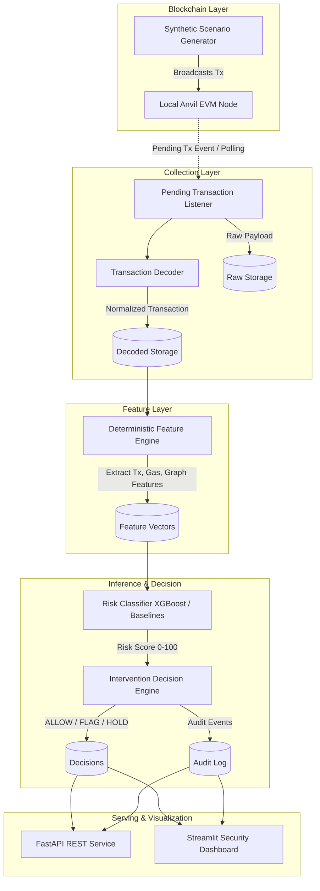

# MempoolGuard System Architecture

## Architecture Overview

## Architectural Components

1. **Shared Contracts (`core/contracts.py`)**:
   Pydantic models ensuring strict type safety and schema validation across transactions, feature vectors, risk results, decisions, and audit records.
2. **Configuration Loader (`core/config.py`)**:
   Tiered configuration system prioritizing environment variables over `configs/config.yaml`.
3. **Database Subsystem (`core/database.py`)**:
   SQLite database operating in WAL mode with connection management, foreign key cascades, and transactional integrity.
4. **Health Diagnostics (`core/health.py`)**:
   Self-healing and diagnostic probes testing database integrity, EVM RPC reachability, directory permissions, and runtime environment.
